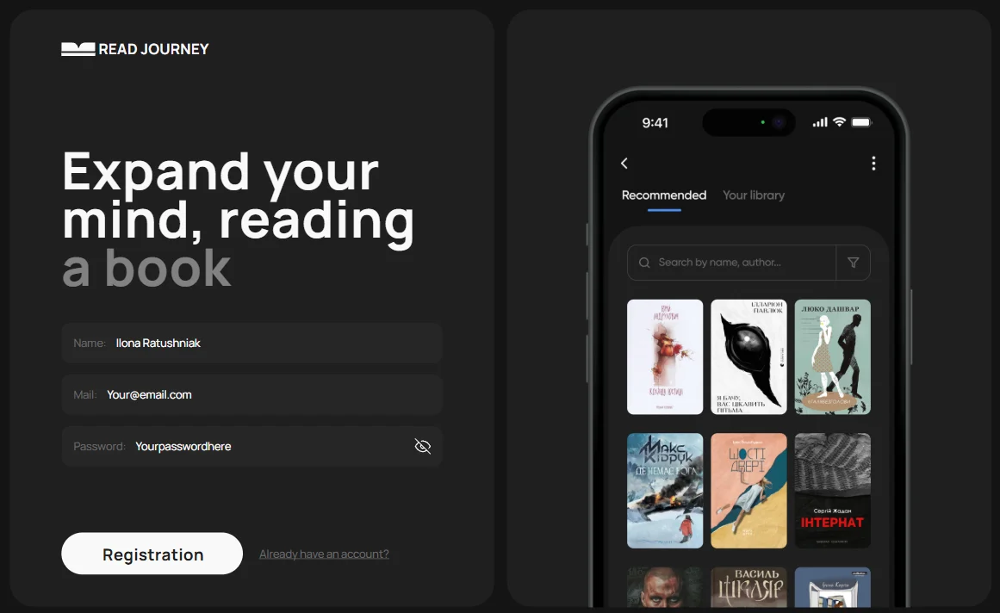
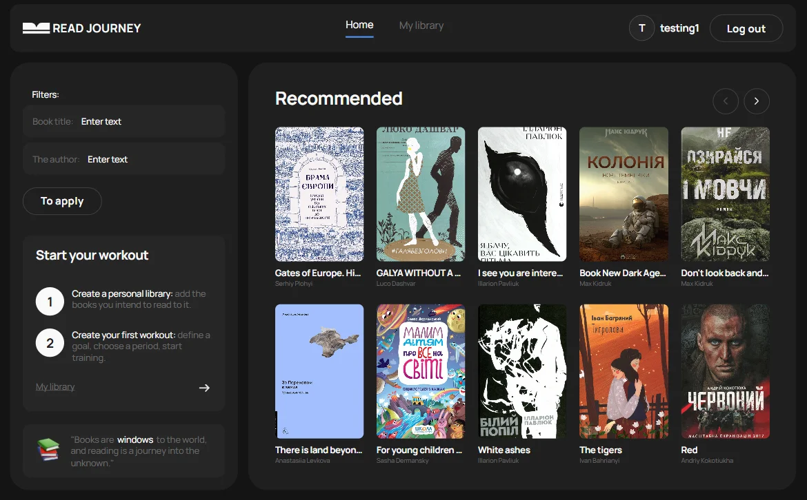
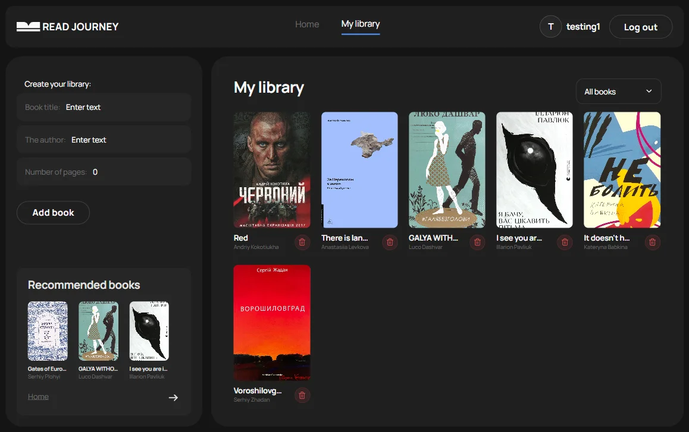
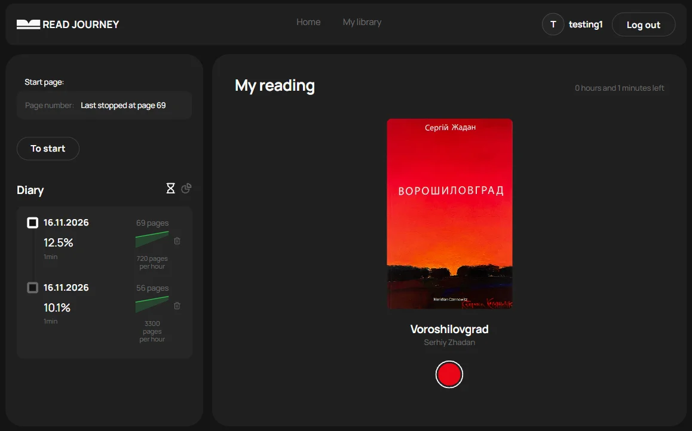
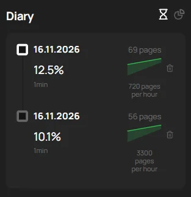
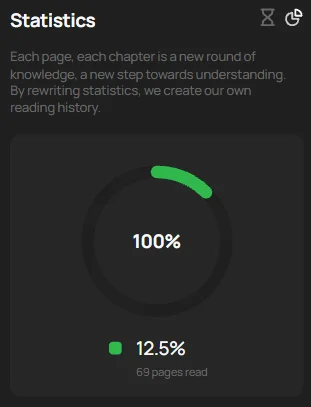
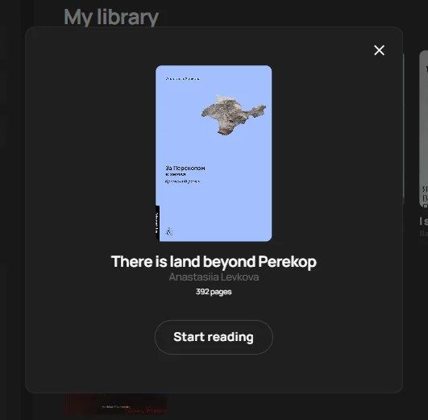

# 📚 Read Journey

<p align="center">
  
</p>

---

## 📖 About the Project

**🌐 Live Page:** [View Project](https://read-journey-wine.vercel.app/).

**Read Journey** is a book tracking application designed to help users organize their personal libraries, track reading progress, and build consistent reading habits.

The application allows users to discover recommended books, create their own library, manage their reading sessions, and monitor their progress through reading statistics and a personal reading diary.

Users can track the number of pages they have read, record reading sessions, calculate reading speed, and view their progress toward completing each book.

The project was developed as a personal portfolio project based on the provided [Figma design](https://www.figma.com/file/z3m0rdBcEfLTJUBDkAKhWQ/BOOKS-READING?type=design&node-id=18743%3A4973&mode=design&t=Hi1KTaUJMogWXZzz-1) and [GoIT backend API](https://readjourney.b.goit.study/api-docs/).

---

## ✨ Features

**🔐 Authentication**

<p>
  
</p>

- User registration and login.
- Automatic authentication after successful registration.
- Retrieve current user information.
- Secure logout with session termination.
- Persistent authentication using access and refresh tokens.
- Protected routes for authenticated users.
- Form validation with Formik and Yup.
- Error handling and toast notifications.

---

**🏠 Recommended Page**

<p>
  
</p>

- Display recommended books fetched from the backend.
- Search books by title and author.
- Combine title and author filters.
- Server-side pagination with configurable page limits.
- Navigate between pages using previous and next buttons.
- Disable pagination buttons when the first or last page is reached.
- Open a book details modal by clicking its cover.
- Add books to the personal library directly from the modal.
- Display book information, including title, author, description, and other available details.

---

**📚 My Library**

<p>
  
</p>

- Add new books to the personal library.
- Validate book information before submitting.
- Display a success modal after successfully adding a book.
- Browse books stored in the user's library.
- Filter books by reading status:
  - Unread.
  - In progress.
  - Done.
- Open a book details modal.
- Start reading a selected book and navigate to the Reading page.
- Remove books from the personal library.
- Display loading, error, and empty states.

---

**📖 Reading Page**

<p>
  
</p>

- Display information about the currently selected book.
- Track the reading process.
- Start a reading session by specifying the starting page.
- Stop a reading session by specifying the finishing page.
- Validate page numbers before submitting.
- Send reading session data to the backend.
- Update reading progress and statistics after completing a session.
- Display a completion modal when the entire book has been read.

---

**📊 Reading Progress**

- Display the current reading progress.
- Show the percentage of the book already completed.
- Track the number of pages read.
- Update progress dynamically after reading sessions.

---

**📅 Diary**

<p>
  
</p>

- Display reading sessions organized by date.
- Show the number of pages read during each session.
- Display the percentage of the book completed.
- Show reading duration.
- Calculate and display reading speed in pages per hour.
- Delete individual reading sessions.
- Scroll through reading history.

---

**📈 Statistics**

<p>
  
</p>

- Visualize reading progress using a chart.
- Display reading activity over time.
- Help users track their progress and understand their reading habits.
- Update statistics based on reading sessions.

---

**🪟 Modal Windows**

<p>
  
</p>

- Reusable modal components for different application features.
- Book details and confirmation dialogs.
- Success and completion notifications.
- Delete confirmation dialogs.
- Modals can be closed by:
  - Clicking the close button.
  - Clicking the backdrop.
  - Pressing the Esc key.

  ---

**🎨 Interface**

- Responsive design based on the provided Figma layout.
- Mobile-first development approach.
- Semantic HTML5 structure.
- Reusable React components.
- CSS Modules for component-scoped styling.
- Consistent typography and design system.
- Hover and focus states for interactive elements.
- Toast notifications for success and error feedback.
- SVG sprite for interface icons.
- Responsive burger navigation on mobile and tablet devices.

---

## 🔌 Backend Integration

The application uses the GoIT backend API to manage user accounts, books, and reading activity.

API Documentation: [Read Journey API](https://readjourney.b.goit.study/api-docs/).

The backend handles:

- User registration, login, and logout.
- Authentication and token management.
- Retrieving the current user.
- Fetching recommended books.
- Searching and filtering books.
- Adding books to the personal library.
- Retrieving the user's library.
- Deleting books from the library.
- Managing reading sessions.
- Calculating reading speed and reading statistics.
- Deleting reading sessions.

Axios is used for HTTP requests, with request interceptors for attaching authentication tokens.

---

## 🛠 Tech Stack

[](https://skillicons.dev)

| Technology           | Purpose                                    |
| :------------------- | :----------------------------------------- |
| **React**            | Building the user interface                |
| **TypeScript**       | Type safety and improved code reliability  |
| **Vite**             | Development environment and build tool     |
| **React Router**     | Client-side routing and protected routes   |
| **Redux Toolkit**    | Global application state management        |
| **Axios**            | HTTP requests and API integration          |
| **Formik**           | Form state management                      |
| **Yup**              | Form validation                            |
| **React Hot Toast**  | Toast notifications                        |
| **CSS Modules**      | Component-scoped styling                   |
| **Modern Normalize** | Consistent default browser styling         |
| **SVG Sprite**       | Reusable interface icons                   |
| **Git & GitHub**     | Version control and source code management |

---

## 📱 Responsive Design

The application is designed to provide a consistent experience across different screen sizes:

- 📱 Mobile: from 320px (fluid layout), with adaptive layout from 375px.
- 📱 Tablet: from 768px.
- 💻 Desktop: from 1440px.

The interface follows a mobile-first approach and adapts its layout, navigation, and content to different viewport sizes.

---

## 🎯 Project Highlights

- 📚 Complete book management workflow.
- 🔐 Authentication with access and refresh token handling.
- 🔎 Book search and filtering.
- 📖 Personal library with reading status management.
- ⏱ Reading session tracking.
- 📊 Dynamic reading progress and statistics.
- 📅 Reading diary with session history.
- 🧮 Reading speed calculation.
- 🪟 Reusable modal components.
- 📝 Form validation with Formik and Yup.
- 🔄 Server-side pagination.
- 📱 Responsive mobile-first interface.
- 🧩 Reusable component-based architecture.
- ⚡ Built with React, TypeScript, and Vite.

---

## 🚀 Installation and Running

**1. Clone the repository**

```bash
git clone https://github.com/OlhaBorzhynska/read-journey.git
```

**2. Navigate to the project folder**

```bash
cd read-journey
```

**3. Install dependencies**

```bash
npm install
```

**4. Run the project in development mode**

```bash
npm run dev
```

**5. Open the application in your browser:**

```bash
http://localhost:5173
```

---

## 👩‍💻 Author

**Olha Borzhynska** — Junior Full-Stack Developer

GitHub: https://github.com/OlhaBorzhynska

LinkedIn: www.linkedin.com/in/olha-borzhynska

Email: mykytlo@gmail.com
